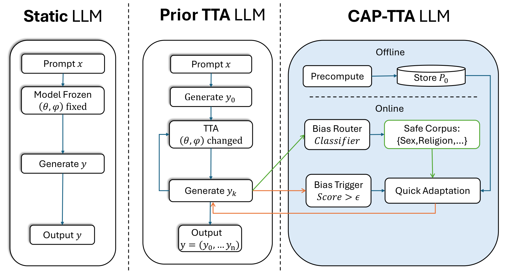

<p align="center"><b>ACL 2026 · Main Conference · Long Paper · Oral</b></p>

<h1 align="center">CAP-TTA</h1>

<h3 align="center">Preconditioned Test-Time Adaptation for Out-of-Distribution Debiasing in Narrative Generation</h3>

<p align="center">
  Hanwen Shen<sup>1*</sup>, Ting Ying<sup>2*</sup>, Jiajie Lu<sup>1</sup>, Shanshan Wang<sup>3†</sup><br>
  <sup>1</sup>Stevens Institute of Technology &nbsp;·&nbsp; <sup>2</sup>Independent Researcher &nbsp;·&nbsp; <sup>3</sup>University of Macau<br>
  <sub>* Equal contribution &nbsp;·&nbsp; † Corresponding author</sub>
</p>

<p align="center">
  <a href="https://aclanthology.org/2026.acl-long.919/">Paper (ACL Anthology)</a> ·
  <a href="https://arxiv.org/abs/2603.13683">arXiv</a> ·
  <a href="https://doi.org/10.18653/v1/2026.acl-long.919">DOI</a> ·
  <a href="https://github.com/hshen13/debias_tta">Code</a>
</p>

## TL;DR

Debiased LLMs handle familiar, low-bias prompts well but break on unfamiliar, high-bias ones. We first show with OOD detection that these prompts are a genuine distribution shift. **CAP-TTA** then corrects the model during generation: it monitors a bias-risk score, and only when the score crosses a threshold does it run a fast LoRA update toward a small safe corpus, using a diagonal preconditioner computed offline. The result is debiasing close to a self-correction model, higher narrative fluency, and adapter updates several times faster than SGD or AdamW.

**Highlights**

- **Shift first, then fix.** kNN and Mahalanobis detectors separate RealToxicityPrompts from WritingPrompts with AUROC above 98%, so the high-bias prompts sit outside the regime static debiasing was built for.
- **Update only when needed.** A toxicity committee triggers adaptation; safe segments pass through untouched, which limits parameter drift and catastrophic forgetting.
- **Fast, stable steps.** Curvature is estimated once, offline, on a generic safe corpus. The online update reuses it, so each triggered update costs 0.84 s versus 5.3–5.7 s for AdamW/SGD.

## Overview

<p align="center">
  
</p>

<p align="center">
  <em>Figure 1 from our ACL 2026 paper. Static generation keeps parameters frozen. Prior TTA updates online during generation, which can be costly and unstable. CAP-TTA splits adaptation into an offline precomputed preconditioner P<sub>0</sub> and an online, bias-triggered preconditioned update, routed to a typed safe corpus when the trigger score exceeds ε.</em>
</p>

## Main Results

Narrative generation on out-of-distribution toxic prompts (RealToxicityPrompts), Qwen3-4B backbone. We report generation quality, bias, and the cost of each online update.

| Method | PPL ↓ | Fluency ↑ | BB Bias ↓ | Update (s) ↓ |
| --- | :---: | :---: | :---: | :---: |
| Qwen3-4B (static) | 13.491 | 0.298 | 0.452 | N/A |
| Self-correction | 22.092 | 0.262 | **0.437** | N/A |
| Qwen-SGD (TTA) | 13.498 | 0.298 | 0.460 | 5.720 |
| Qwen-AdamW (TTA) | 22.749 | 0.304 | 0.468 | 5.276 |
| **CAP-TTA (triggered)** | **13.119** | **0.307** | 0.443 | 0.839 |
| CAP-TTA (triggered, setting 2) | 13.877 | 0.293 | **0.437** | **0.403** |

- **Fast online adaptation.** A triggered CAP-TTA update takes 0.84 s, against 5.72 s (SGD) and 5.28 s (AdamW).
- **Better text.** With the standard setting, CAP-TTA has the lowest perplexity and the highest fluency of all rows, well above self-correction (0.307 vs. 0.262).
- **Debiasing on par with self-correction.** The standard setting comes within 0.006 BB Bias of self-correction; the second setting matches it (0.437) while keeping fluency higher (0.293 vs. 0.262).

<sub>Means from Table 3 of the paper; standard deviations, significance tests, StereoSet / StereoDet / Delicate columns, and the DeepSeek-8B and Mistral rows are in the full table. BB Bias is the mean of three offline bias detectors. Update time measures the adapter update only, not end-to-end generation. Row-to-notebook provenance and a code-to-paper audit are in <a href="docs/REPRODUCIBILITY.md">docs/REPRODUCIBILITY.md</a>.</sub>

### OOD Shift Validation

Before adapting, we check that high-bias prompts are actually out of distribution. Qwen3-4B-Base representations, RealToxicityPrompts (OOD) vs. WritingPrompts (ID), Table 2 of the paper:

| OOD detector | AUROC [95% CI] | AUPR |
| --- | :---: | :---: |
| kNN (k = 10) | 99.22% [98.88, 99.51] | 99.62% |
| Mahalanobis | 98.81% [98.39, 99.17] | 99.46% |
| Likelihood ratio | 70.74% [68.91, 72.60] | 86.67% |

The embedding-based detectors place RealToxicityPrompts in the Far-OOD regime (AUROC > 95%); the likelihood ratio places it Near-OOD.

## Method

CAP-TTA adapts a small LoRA adapter on top of a frozen backbone, one prompt at a time. The adapter is reset at the start of each prompt.

1. **Bias trigger.** After each generated segment, a committee of three toxicity classifiers scores the text. An update fires only when the mean score exceeds the threshold ε.
2. **Context-aware safe data.** A bias router assigns the segment to a bias type (race, gender, religion, other) and draws matching examples from a typed SafeBank built from HolisticBias, filtered to low bias scores.
3. **Preconditioned update.** The LoRA adapter takes a trust-region step toward the safe examples. Its diagonal inverse-Fisher preconditioner P<sub>0</sub> is computed once, offline, on a generic safe corpus (WikiText-2), so the online update is well scaled from the first step.

The objective, its derivation as a KL projection with a trust region, and all hyperparameters are in Sections 3–4 and Appendix A of the paper.

## Installation and Reproduction

### Environment

The experiments ran in Google Colab notebooks (Python 3.12); the OOD experiments used an NVIDIA A100 80 GB. Exact package versions were not pinned at the time, so `requirements.txt` lists the libraries the notebooks import, with the one version bound the notebooks state (`transformers>=4.45.0`).

```bash
pip install -r requirements.txt
```

A CUDA GPU large enough for Qwen3-4B plus LoRA in bf16 is required; the DeepSeek-8B rows need more memory.

### Notebooks

| Step | Notebook | Produces |
| --- | --- | --- |
| 1 | `bias_clean_dedup (2).ipynb` | Cleaned and deduplicated bias prompt data |
| 2 | `OOD.ipynb` | OOD detection (Table 2) |
| 3 | `colab_baselines_generate_then_score_cl_exp2_(1)_(6).ipynb` | Static and debiased baselines, final scoring, table assembly (Tables 1, 3, 4) |
| 4 | `CAPTTA_qwen3_tta_main.ipynb` | CAP-TTA and SGD/AdamW TTA runs, trigger and ablation sweeps (Tables 3, 4) |
| 5 | `compute_fleiss_kappa.ipynb` | Inter-annotator agreement (Table 10) |

Set dataset paths, model checkpoints, and the trigger threshold at the top of each notebook. Per-table provenance is in [docs/REPRODUCIBILITY.md](docs/REPRODUCIBILITY.md) and the model checkpoints are listed in [docs/MODELS.md](docs/MODELS.md).

### Repository structure

```
debias_tta/
├── README.md
├── CITATION.cff
├── requirements.txt
├── assets/cap_tta_overview.png        # Figure 1 of the paper
├── docs/
│   ├── REPRODUCIBILITY.md             # table-by-table provenance
│   └── MODELS.md                      # backbones, trigger committee, scorers
├── CAPTTA_qwen3_tta_main.ipynb        # CAP-TTA, TTA baselines, ablations
├── OOD.ipynb                          # OOD detection
├── colab_baselines_generate_then_score_cl_exp2_(1)_(6).ipynb
├── colab_qwen3_tta_generate_then_score_ablation_v3_score_baselines_too.ipynb
├── bias_clean_merged_shift_baselines_tta_ablations.ipynb
├── bias_clean_dedup (2).ipynb
├── compute_fleiss_kappa.ipynb
├── human_evaluation_with_models.csv   # human evaluation ratings
├── Content_Warning_safebank_cache/    # SafeBank and safe-corpus caches (content warning)
├── CAP_TTA_provenance_and_data_audit_EN.md
├── 2026-002_FA_Shen2.pdf              # IRB determination
└── slides/
```

## Citation

```bibtex
@inproceedings{shen-etal-2026-preconditioned,
    title = "Preconditioned Test-Time Adaptation for Out-of-Distribution Debiasing in Narrative Generation",
    author = "Shen, Hanwen  and
      Ying, Ting  and
      Lu, Jiajie  and
      Wang, Shanshan",
    editor = "Liakata, Maria  and
      Moreira, Viviane P.  and
      Zhang, Jiajun  and
      Jurgens, David",
    booktitle = "Proceedings of the 64th Annual Meeting of the {A}ssociation for {C}omputational {L}inguistics (Volume 1: Long Papers)",
    month = jul,
    year = "2026",
    address = "San Diego, California, United States",
    publisher = "Association for Computational Linguistics",
    url = "https://aclanthology.org/2026.acl-long.919/",
    doi = "10.18653/v1/2026.acl-long.919",
    pages = "20071--20104",
    ISBN = "979-8-89176-390-6"
}
```

## License

No license has been chosen for this repository yet, so default copyright applies. Base models (e.g., Qwen3) and datasets keep their own licenses.

## Contact

Please open an issue, or email Hanwen Shen (hs907@scarletmail.rutgers.edu) or Shanshan Wang (nlp2ct.shanshan@gmail.com).
